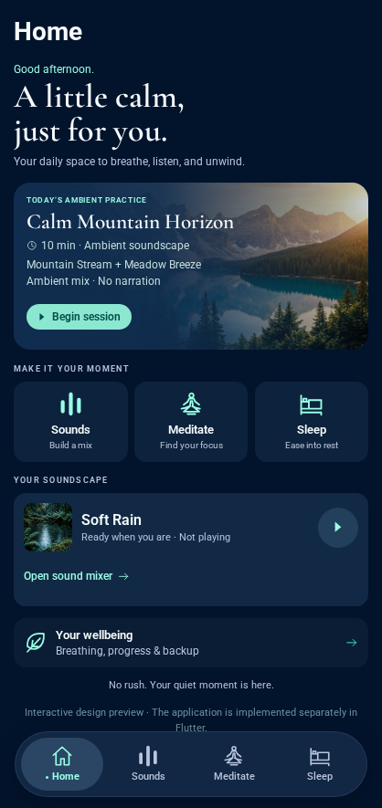

# Sanctuary — Relax & Mindfulness

A Flutter app for ambient sound mixing, timed unguided practices, breathing and sleep routines. The current experience is **Home / Sounds / Meditate / Sleep**, with one shared Sleep night-sky background, midnight-blue surfaces, a floating footer and shared playback state. There is **no in-page Install app button**.



[Sounds](design/sounds-no-install-mobile-preview.png) · [Meditate](design/meditate-no-install-mobile-preview.png) · [Sleep](design/sleep-no-install-mobile-preview.png) · [Preview guide](design/README.md)

These are **independent HTML captures**, not compiled Flutter or native-device screenshots. The same approved visual direction is implemented in the Flutter source, but browser behavior does not verify physical-device behavior.

## Status

**Pre-release / launch BLOCKED. Purchases remain off.** There are **202 pending rights reviews and release gates**; passing tests is not permission to publish, sign, upload to TestFlight/stores, enable purchases or spend money. See [readiness](docs/LAUNCH_READINESS.md), [launch hardening](docs/LAUNCH_HARDENING.md) and the unfilled [device/listening checklist](docs/release/DEVICE_QA.md).

The owner-approved [PR #1](https://github.com/ceo06ytlegend14/relax-mindfulness-flutter/pull/1) brought the current design into `main`. Both pre-merge runs and the [post-merge main run](https://github.com/ceo06ytlegend14/relax-mindfulness-flutter/actions/runs/45795349126) passed all four jobs: **429 Flutter tests**, analysis/scoped formatting, web compilation, browser/Python checks, Android debug/unsigned release and unsigned iOS compilation. Those results identify the **pre-cleanup** source; see [exact-source build evidence](docs/release/BUILD_CHECKS.md) for the current cleanup's verification boundary. A source merge is not a website deployment or an installable iPhone build.

**Shared-background checks:** **350/350 browser/Node + 97/97 Python**, zero failures/skips; 56 foreground comparisons preserve layout/styles and 54 responsive checks pass. The original Sleep page remains pixel-identical at five sizes; the other pages intentionally gain its sky. All 96 declared bundled inputs are unchanged. [Current verification and hosted-check boundary](docs/release/BUILD_CHECKS.md#shared-sleep-background--current-visual-change). Historical cleanup/main results do not certify this later change.

## What stays in the app

- **Home:** the daily calm, shortcuts, shared soundscape and wellbeing destinations.
- **Sounds:** 18 bundled sources by default; all 77 stable catalog identities remain behind explicit unfinished-catalog review. Keep independent levels, ten [exact curated recipes](docs/CURATED_SOUND_MIXES.md), eight legacy mixes, favorites, custom saves and [safe recording replacement](docs/SOUND_LIBRARY.md).
- **Playback:** individual switches/sliders stay on Sounds with the mini-player. Deliberate whole-mix starts may expand the player; minimizing never stops a healthy mix. Loading, retry, cancellation, pause, timers/fades and availability stay truthful. [Player behavior and limits](docs/AMBIENT_PLAYER.md).
- **Meditate:** today plus three starters, all 14 practices reachable, Save/filters and source-labeled ambient arrangements—not spoken guidance. [Library flow](docs/SIMPLE_LIBRARY_FLOW.md) · [23 session arrangements](docs/SESSION_AUDIO.md).
- **Sleep:** moonlit artwork, preferred outlined mixer controls, playlists, nighttime journeys and auto-fade timer. No invented story narration or listening history.
- **Wellbeing:** breathing, actual recorded progress, local reflection and staged [native backup/restore](docs/BACKUPS.md). The browser preview has separate local history and a clearly labeled layout-only backup page.

Temporary loop edits are **not new recordings or rights clearance**. The target remains **18 sounds × 3 genuinely different recordings = 54 choices**, plus varied long loops. [Development audio scope](docs/PLACEHOLDER_AUDIO.md) · [recording provenance](docs/audio-licenses/ambient-pack-2026-11-19.md).

## Project layout and cleanup

| Path | Purpose |
| --- | --- |
| `design/preview/` | The working interactive browser preview. Its asset/installer links use the canonical source files, not copied bundles. |
| `design/*.png` | Only the four current tab captures above. Superseded screenshots remain recoverable from Git history. |
| `lib/` | Flutter app code needed for the real phone application. Not a duplicate preview folder to delete. |
| `assets/` | Actual audio, artwork, authored fonts and their provenance/licence records. |
| `android/`, `ios/` | Native build projects; app identities and signing safeguards are preserved. |
| `web/` | Flutter web bootstrap, PWA/offline support, privacy and existing owner utility pages. |
| `test/`, `tool/`, `.github/` | Regression tests, media/build verification and configured non-deploying CI. |
| `docs/` | Focused behavior, release, phone-testing and business handoffs. |

The cleanup removes **57 superseded screenshots, nine old Flutter-export artifacts and two unreferenced showcases**. It retains the working preview, active native routes, all declared bundled assets, source licences and every regression. Old export manifests, copied icon/font/shader files and the generated aggregate `NOTICES` belonged to a previous build; Flutter regenerates its dependency assets/notices under `build/`. Ignore rules prevent those leftovers from being re-added.

This reduces the **current source checkout**, not Git history or the installed-app size by the same amount. No history rewrite or audio recompression is involved. See the [cleanup verification](docs/release/BUILD_CHECKS.md#source-cleanup--local-verification).

## Open the interactive preview

```sh
node tool/version_preview_assets.mjs
python3 -m http.server 3000 --bind 0.0.0.0 --directory design/preview
```

Open `/`, `/#sounds`, `/#meditate` or `/#sleep`. If a healthy port-3000 server already exists, reuse it. Run the versioning command after changing preview CSS/JS, then reload; do not clear saved selections. [Preview and cache details](design/README.md#open-the-interactive-preview).

Only local sources play in this independent preview; app-stream and missing sources are disclosed without substitution. Installing the **Sanctuary Design Preview** does not install Flutter, cache the full audio library or validate a native app.

## Run the Flutter app

Minimum Flutter **3.32 / Dart 3.8**, with the committed lockfile. Quality automation pins **Flutter 3.38.10**, Java **17**, Android target **36** / minimum **24**, and Xcode **26.3**. [Native runbook](docs/NATIVE_RELEASE.md) · [iPhone-only preparation](docs/IPHONE_FIRST_TESTING.md).

```sh
flutter pub get --enforce-lockfile
flutter run
```

Core screens and bundled audio need no private API key. Reflection is a local writing template, not an AI/music service. `.env.example` is guidance, not automatically loaded Flutter configuration. Never compile secret REST keys or signing credentials into a client app.

## Checks

```sh
# Development-only browser and Python checks:
npm ci --ignore-scripts
npx playwright install --with-deps chromium
npm run test:web
python3 -m unittest discover -s tool -p 'test_*.py' -v
python3 tool/launch_preflight.py --inventory-only

# With the pinned Flutter SDK:
flutter analyze --no-fatal-infos
flutter test
flutter build web --release
```

`PLAYWRIGHT_MODULE` and `CHROMIUM_PATH` can reuse existing browser tools. `npm run test:pwa` and `npm run test:platform` run the static subsets. Full preflight without `--inventory-only` intentionally exits **1 / BLOCKED** while evidence is pending; inventory-only success is not release approval.

The SHA-pinned [quality workflow](.github/workflows/quality.yml) has no production signing secrets, app-binary upload, deployment or store-submission step. Test failures, lock drift and analyzer errors/warnings fail their jobs; advisory analyzer infos do not.

## Owner-controlled next steps

- Review rights/claims and perform actual device/audio/background/interruption/accessibility tests. HTML screenshots, browser telemetry and unsigned compilation are separate evidence.
- Confirm existing store identities before any change; the iOS source identity is still **Zen Night / `com.sagozen.zennight`**. No signing or TestFlight upload has occurred.
- Resolve the historical exposed-credential incident through owner-controlled revocation/rotation and usage review. Removing files does not revoke a key or erase history.
- Approve real support/privacy/terms destinations and complete the [billing sandbox gates](docs/BILLING.md) before enabling sales. Existing restore/access relies on SDK entitlements, not local premium flags.
- Follow the [revenue roadmap](docs/REVENUE_ROADMAP.md), [interview kit](docs/business/CUSTOMER_INTERVIEWS.md) and [blank scorecard](docs/business/weekly-scorecard-template.csv): useful conversations, a cleared/device-tested approved beta, returning testers, then genuine payers. Demand and monthly income are not guaranteed; ads remain **$0** pending evidence and separate approval.
